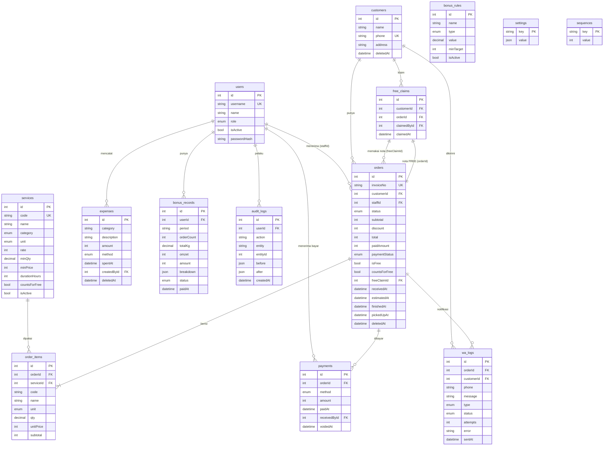

# 2. ERD & Daftar Endpoint

## ERD

## Endpoint (prefix `/api`, JWT kecuali login; **O** = hanya Owner)
| Modul | Method & path | Keterangan |
|---|---|---|
| Auth | `POST /auth/login` | username + password → token |
| | `GET /auth/me` · `POST /auth/change-password` | |
| Staff | `GET /users` **O** · `POST /users` **O** · `PATCH /users/:id` **O** · `POST /users/:id/reset-password` **O** | |
| Layanan | `GET /services` (`?all=1` O) · `POST /services` **O** · `PATCH /services/:id` **O** | |
| Customer | `GET /customers?q&unpaid&sort` · `POST` · `GET /:id` · `PATCH /:id` · `DELETE /:id` **O** | rekap + progres FREE |
| | `GET /customers/export` | Excel rekapan |
| Order | `GET /orders?date&status&payment&q&mine` · `POST /orders` · `GET /orders/:id` | |
| | `PATCH /orders/:id/status` `{status}` | Selesai → WA otomatis |
| | `PATCH /orders/:id` (catatan/diskon) · `POST /orders/:id/cancel` · `DELETE /orders/:id` **O** | |
| Bayar | `POST /orders/:id/payments` `{method, amount}` · `POST /orders/:id/pay-full` `{method}` | Tandai Lunas |
| | `DELETE /payments/:id` **O** | void pembayaran |
| Dashboard | `GET /dashboard` | 4 angka utama + Cash/QRIS hari ini |
| Cashflow | `GET /cashflow/summary?period=day\|week\|month&date` | masuk, keluar, bersih, Cash vs QRIS, per hari |
| | `GET /cashflow/transactions?period&date` | daftar harian seperti buku |
| | `GET /cashflow/export?period&date` | Excel |
| | `GET/POST /expenses` · `PATCH/DELETE /expenses/:id` | pengeluaran |
| FREE | `GET /free` | progres semua customer + yang berhak klaim |
| | `POST /free/claim` `{customerId, serviceId, qty}` | buat nota FREE |
| | `GET /free/claims` | riwayat klaim |
| Bonus | `GET /bonus/rules` · `PUT /bonus/rules` **O** | aturan |
| | `GET /bonus/me?period=YYYY-MM` | Bonus Saya |
| | `GET /bonus/summary?period` **O** · `POST /bonus/records/generate` **O** · `PATCH /bonus/records/:id/pay` **O** | |
| Staff perf | `GET /staff/performance?period` **O** · `GET /staff/daily-recap?date` | omzet, nota, kg · rincian harian |
| WA | `GET /wa/logs` · `POST /wa/logs/:id/resend` · `POST /wa/test` **O** · `GET /wa/status` | |
| Pengaturan | `GET /settings` · `PUT /settings` **O** | template WA, toko, FREE |
| Audit | `GET /audit` **O** | riwayat perubahan |
